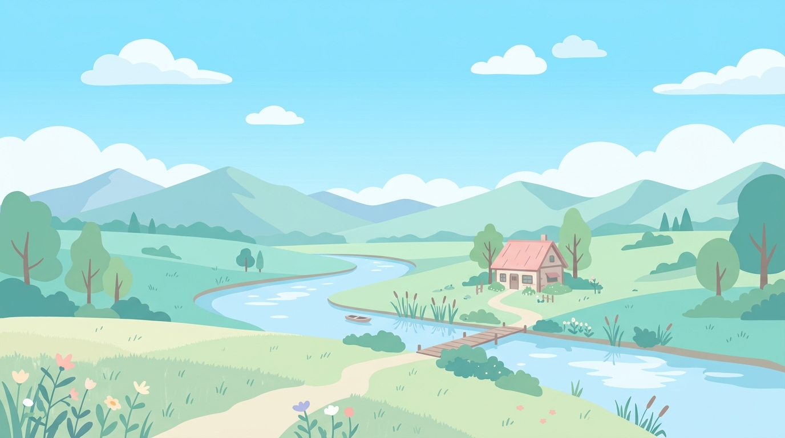

<div align="center">
  
</div>

<h1 align="center">✨ Chronicles - Anime Cinematic Portfolio 🌸</h1>

<p align="center">
  An anime-inspired cinematic portfolio and landing page featuring 2D parallax scrolling, Three.js 3D WebGL scenes, and smooth scene transitions without page reloads.
</p>

<div align="center">
  
  
  
  
</div>

---

## 📖 Table of Contents
- [The Story Behind This Project](#-the-story-behind-this-project)
- [Key Features](#-key-features)
- [Tech Stack](#-tech-stack)
- [Installation and Usage](#-installation-and-usage)
- [File Structure](#-file-structure)
- [License](#-license)
- [Author](#-author)

---

## 💡 The Story Behind This Project

This project aims to combine traditional anime-inspired visual aesthetics (think Studio Ghibli or Makoto Shinkai style backgrounds) with modern frontend web engineering. By leveraging Vanilla HTML, CSS, and JavaScript, the project avoids heavy frontend frameworks while delivering a high-performance Single Page Application (SPA).

I wanted to include cinematic transitions that mimic movie scene cuts, a multi-layer 2D parallax system for atmospheric depth, and an interactive 3D WebGL background using Three.js. After several iterations—and a lot of debugging with overlapping layers—it finally culminated into this highly polished, responsive landing page. 

---

## 🚀 Key Features

- **Single Page Application (SPA):** Seamless navigation between sections (Home, About, Contact, Login, Register) without triggering a browser window reload, driven purely by the History API.
- **2D Parallax Engine:** A dual-engine parallax implementation (GSAP ScrollTrigger + Vanilla JS RAF Fallback) providing distinct movement depth to sky, clouds, and ribbons.
- **Cinematic Scene Transitions:** A custom 4-phase shutter transition utilizing CSS keyframes, featuring anime speedline rays and kanji crests before revealing the destination page.
- **Three.js WebGL Centerpiece:** A fully integrated 3D Canvas rendering a massive, real-time glowing Torus Knot / Atom with pink and cyan emissive materials in the background.
- **Ghibli Theme Palette:** A soft, pastel color scheme combined with custom CSS variables that drive consistent aesthetics across all sections.

---

## 🛠 Tech Stack

- **Markup & Styling:** HTML5, CSS3, CSS Variables, Keyframe Animations
- **Logic & Routing:** Vanilla JavaScript (ES5/ES6)
- **3D Rendering:** Three.js (r128)
- **Animation Libraries:** GSAP (ScrollTrigger)
- **Icons:** FontAwesome

---

## ⚙️ Installation and Usage

1. Clone or download the repository.
2. Navigate to the `anime_portfolio` folder.
3. Open `index.html` directly in any modern web browser (Google Chrome, Firefox, Safari, Edge).
4. For the best experience, host the files using a local server (e.g. VS Code Live Server) to bypass any strict local CORS policies that might affect asset loading.

---

## 📂 File Structure

```text
anime_portfolio/
├── css/
│   ├── main.css           # Base styles, global variables, and layout
│   ├── parallax.css       # 2D depth layers and z-index sandwich stacking
│   ├── sections.css       # Specific styles for About, Contact, Auth pages
│   └── transitions.css    # Cinematic shutter and animation keyframes
├── js/
│   ├── app.js             # Core SPA Router, history management, DOM delegation
│   ├── parallax.js        # ScrollTrigger and Vanilla RAF fallback engine
│   └── three-scene.js     # Three.js 3D Atom rendering loop and initialization
├── libs/
│   ├── gsap.min.js        # Vendored GSAP core
│   ├── ScrollTrigger.min.js
│   └── three.min.js       # Vendored Three.js library
├── pic/                   # Assets (vector landscapes, clouds, icons, patterns)
└── index.html             # The main entry point
```

---

## 📜 License

This project is open-source and available under the MIT License.

---

## 🙋‍♂️ Author

Crafted with passion by **Dibyaranjan**.
